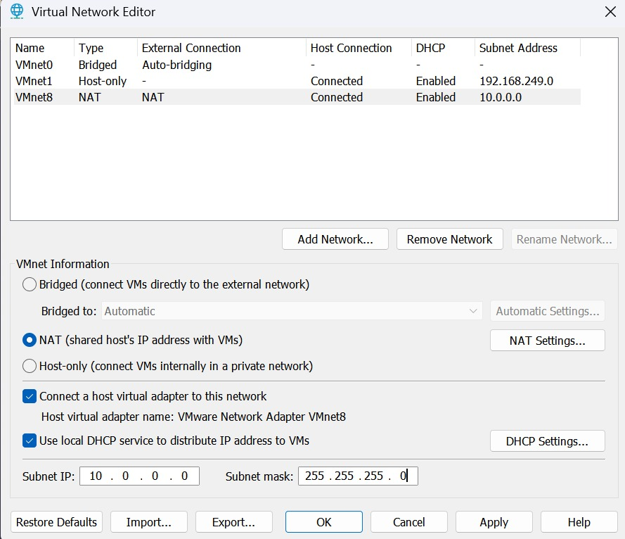
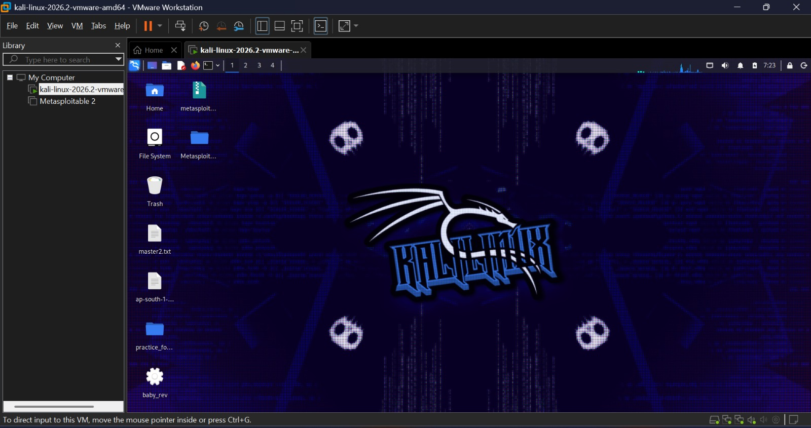
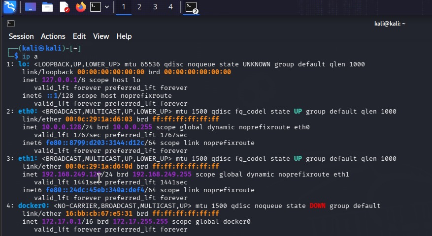
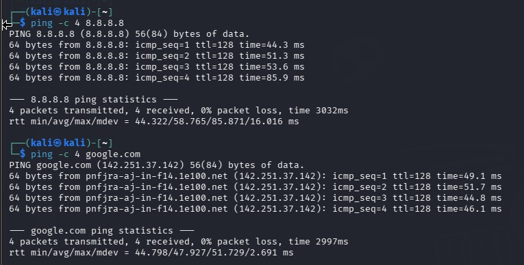

# WK1-PM1: Lab Setup (VMware + Kali Linux)

**Networkwalks Internship | Week 1 | Project Module 1**

## Objective
Set up an isolated cybersecurity testing lab with Kali Linux as the attacker machine on a custom NAT network (`10.0.0.0/24`).

## Lab Details
| Item | Configuration |
|---|---|
| Host OS | Windows 11 |
| Hypervisor | VMware Workstation *(update version)* |
| Attacker VM | Kali Linux (VMware image) |
| Network | Custom NAT (`VMnet8`), `10.0.0.0/24` |
| NAT Gateway | `10.0.0.254` |
| Kali IP | `10.0.0.2/24` (static) |
| DNS | `8.8.8.8` |
| Clipboard & Drag/Drop | Bidirectional |

## Steps

### 1. Install Tools and Download Kali
Install 7-Zip and VMware on the host, then download the Kali VMware image from [kali.org/get-kali](https://www.kali.org/get-kali/).

<p align="center">
  
</p>

### 2. Configure the Virtual Network
Open `Edit > Virtual Network Editor > Change Settings`:
- Select `VMnet8` (NAT), Subnet IP `10.0.0.0`, Subnet mask `255.255.255.0`
- NAT Settings: Gateway IP `10.0.0.254`
- DHCP Settings: range `10.0.0.100 – 10.0.0.200`

<p align="center">
  
</p>

### 3. Import Kali into VMware
Extract the Kali image with 7-Zip, then use `File > Open` and select the `.vmx` file (choose "I copied it" if prompted).

<p align="center">
  
</p>

### 4. Configure VM Settings
In `VM > Settings`:
- Network Adapter: NAT
- Options > Guest Isolation: enable Drag and Drop and Copy and Paste

### 5. Set the Static IP in Kali
Go to Edit Connections > Wired connection 1 > IPv4:
- Method: Manual
- Address `10.0.0.2`, Netmask `24`, Gateway `10.0.0.254`, DNS `8.8.8.8`

### 6. Take a Snapshot
`VM > Snapshot > Take Snapshot`

## Verification
```bash
ip a                  # shows 10.0.0.2/24
ping -c 4 10.0.0.254  # gateway
ping -c 4 8.8.8.8     # internet
ping -c 4 google.com  # DNS
```

<p align="center">
  
</p>

<p align="center">
  
</p>

## Troubleshooting
- **No internet:** confirm VMnet8 settings and gateway IP, and make sure no other VM uses `10.0.0.2`.
- **Network issues:** restart NetworkManager with `sudo systemctl restart NetworkManager`.
- **Clipboard/drag-drop not working:** run `sudo apt install open-vm-tools open-vm-tools-desktop`, then reboot.

## Disclaimer
For educational use only, in an isolated lab environment.
