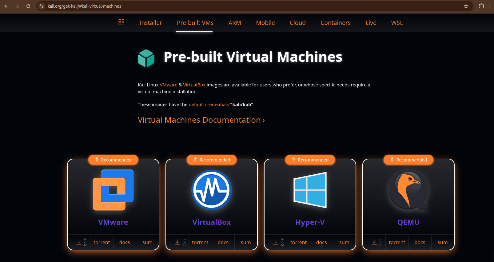

# WK1-PM1: Lab Setup (VMware + Kali Linux)

**Networkwalks Internship | Week 1 | Project Module 1**

## Objective
Set up an isolated cybersecurity testing lab with Kali Linux as the attacker machine on a custom NAT network (`10.0.0.0/24`).

## Lab Details
| Item | Configuration |
|---|---|
| Host OS | Windows 11 *(update)* |
| Hypervisor | VMware Workstation *(Pro/Player, update version)* |
| Attacker VM | Kali Linux (VMware image) |
| Network | Custom NAT (`VMnet8`), `10.0.0.0/24` |
| NAT Gateway | `10.0.0.254` |
| Kali IP | `10.0.0.2/24` (static) |
| DNS | `8.8.8.8` |
| Clipboard & Drag/Drop | Bidirectional |
| Shared Folder | Host `Downloads` folder |

## Steps
1. Install 7-Zip and VMware on the host.
2. Configure the network: `Edit > Virtual Network Editor > Change Settings`
   - Select `VMnet8` (NAT), Subnet IP `10.0.0.0`, Subnet mask `255.255.255.0`
   - NAT Settings: Gateway IP `10.0.0.254`
   - DHCP Settings: range `10.0.0.100 – 10.0.0.200`
3. Download the Kali VMware image from kali.org/get-kali, extract with 7-Zip, then `File > Open` the `.vmx` file (choose "I copied it" if prompted).

4. Configure VM settings (`VM > Settings`):
   - Network Adapter: NAT
   - Options > Guest Isolation: enable Drag and Drop and Copy and Paste
   - Options > Shared Folders: Always enabled, add host `Downloads` folder
5. Set the static IP in Kali (Edit Connections > Wired connection 1 > IPv4):
   - Method: Manual
   - Address `10.0.0.2`, Netmask `24`, Gateway `10.0.0.254`, DNS `8.8.8.8`
6. Take a snapshot: `VM > Snapshot > Take Snapshot`.

## Verification
```bash
ip a                  # shows 10.0.0.2/24
ping -c 4 10.0.0.254  # gateway
ping -c 4 8.8.8.8     # internet
ping -c 4 google.com  # DNS


```

## Troubleshooting
- No internet: confirm VMnet8 settings and the gateway IP, and make sure no other VM uses `10.0.0.2`.
- Try restarting NetworkManager: `sudo systemctl restart NetworkManager`
- Clipboard/drag-drop or shared folders not working: `sudo apt install open-vm-tools open-vm-tools-desktop`, then reboot.
- Shared folder not mounted: `sudo vmhgfs-fuse .host:/ /mnt/hgfs -o allow_other`


## Disclaimer
For educational use only, in an isolated lab environment.
